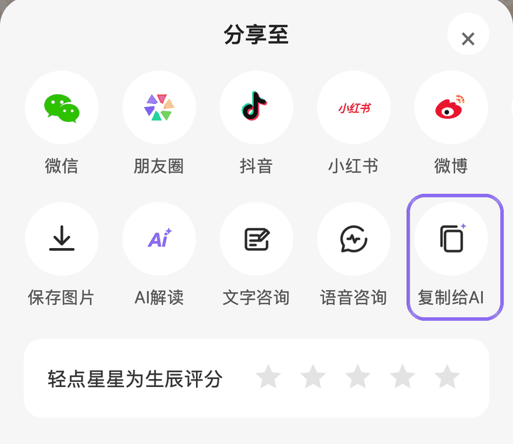
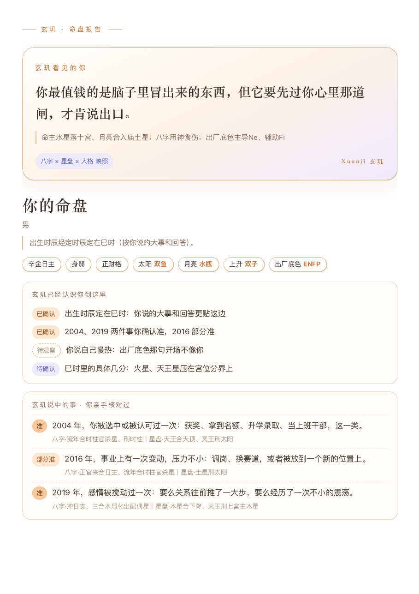
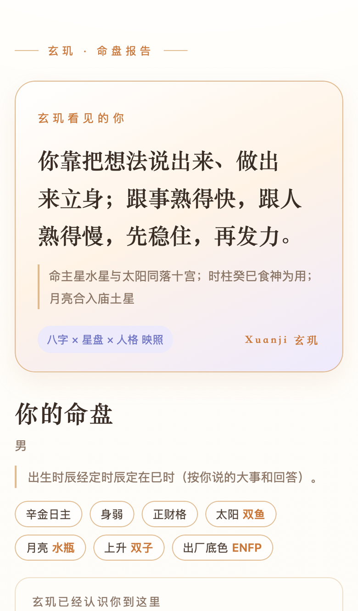
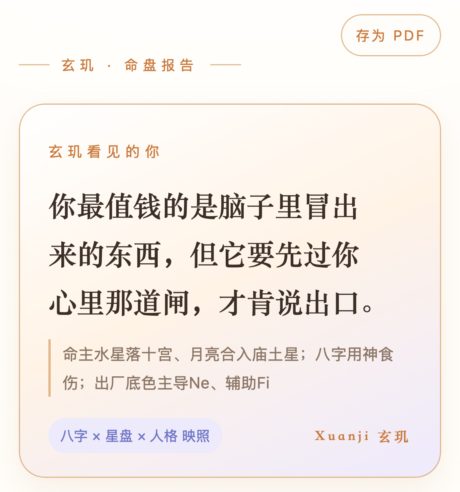
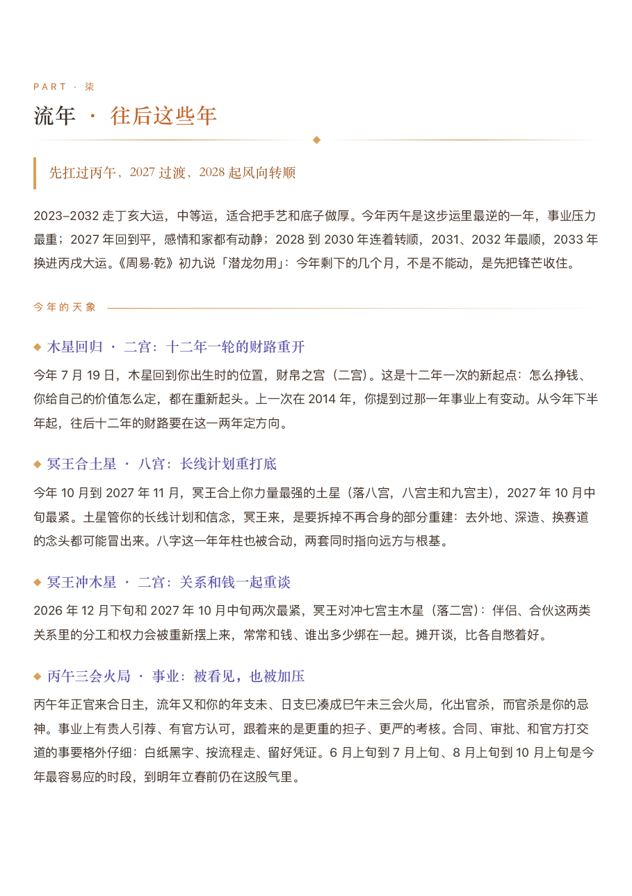
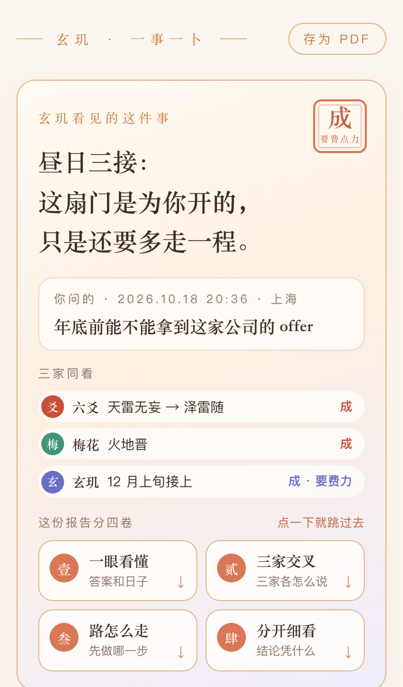
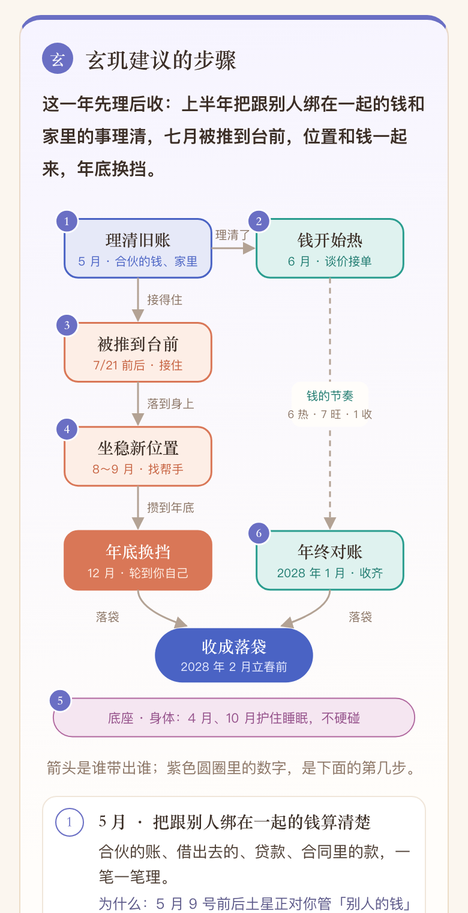
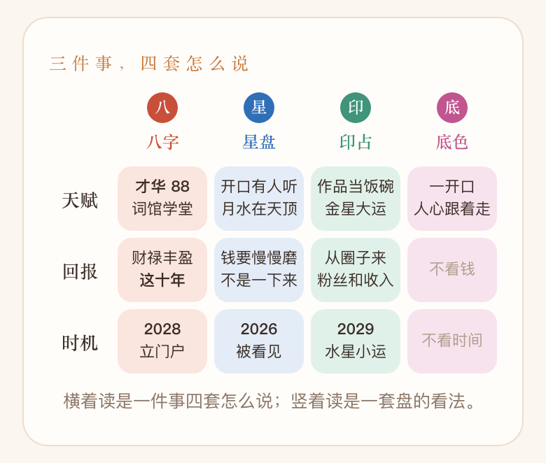
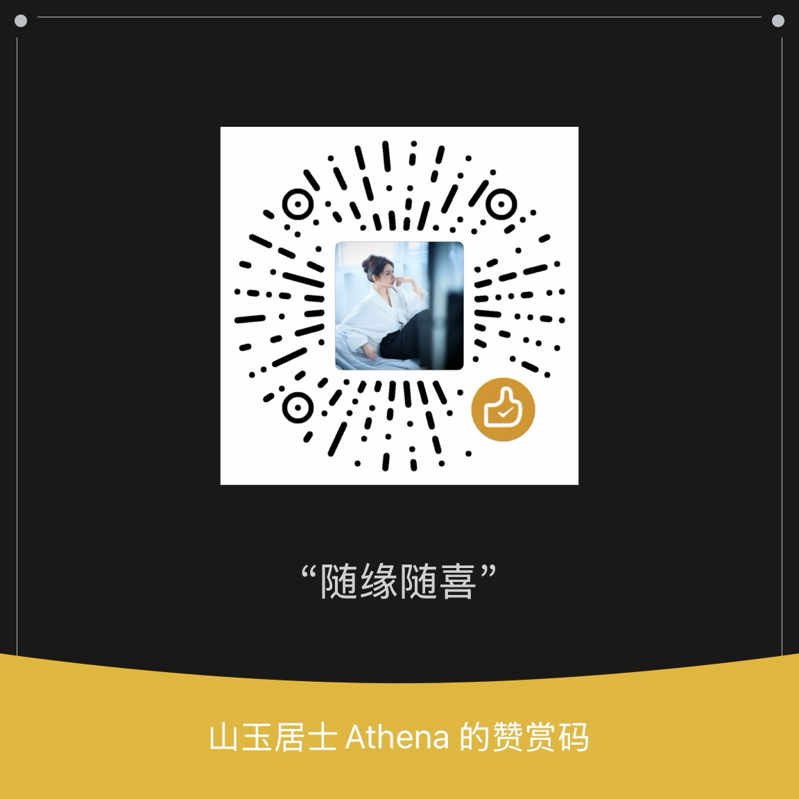

# 执天玄玑 / Xuanji Skill

**让你的 AI 助手学会看结构。**

装上它，支持 Skill 的 AI（比如 Claude Code）就能调用执天玄玑 API：排八字和西洋星盘，讲你的出厂底色、重生人格和人格 Buff，看两个人的关系，还能生成一份离线的 HTML 品牌报告；一件事成不成可以起一卦（一事一卜），某一年怎么走、一件事几套盘分开说，也各有一份报告（年度、分术）。

**不装 Skill 也能用**：在执天玄玑网站排好盘，点「复制给AI」，贴给豆包、DeepSeek、Kimi、ChatGPT 都行，怎么弄见[下面](#不装-skill-也能用复制给-ai)。

它说话的方式是「用命，不算命」：讲的是你的结构是什么、默认怎么运行、你怎么用它，这是关于你是谁、适合什么、怎么做的命题，而不是「你命里注定什么」。结构是稳定的；流年是天气，只决定顺风还是逆风。

> 由杭州强势播传文化影视传媒有限公司提供。它是面向 AI 助手的 Skill/API 客户端，不是"执天玄玑自研大模型"；服务可以使用自有算法、规则系统及第三方 AI 服务。当前计算 API 仍为预览入口，不承诺正式服务 SLA。

## 不装 Skill 也能用：复制给 AI

手机上用豆包、DeepSeek、Kimi、ChatGPT 的，不用装任何东西：

1. 打开执天玄玑网站 https://xuanji-astro.com ，登录后排好你的盘；
2. 进**生辰页**，点右上角的**分享**，在第二排点**「复制给AI」**；
3. 打开你常用的 AI，把刚复制的内容粘贴进去，发出去。

<p></p>

复制的是一段文字：你的八字、星盘、出厂底色和流年，加上玄玑的读法。AI 读完会先说几件你过去的事请你核对，再回答你想问的。这段文字不含你的出生日期、时间和地点。

想要整份图文报告（HTML／PDF），用这个 Skill 出。

## 装好之后是什么体验

你在自己的 AI 里说一句：

> 用 Xuanji 看我的人格结构

它会问你的出生日期、城市和性别，征得你同意后调用 API，然后像老命理师第一次见面那样：先直接说出几件带年份的往事，请你逐条回「准 / 部分准 / 不准」，再展开讲你的结构。你核对过的往事会写进报告：

<p></p>

你说「生成报告」，会得到一个离线 HTML 文件，双击就能打开，不联网、无追踪；电脑上装了 Chrome 或 Edge（Windows 自带 Edge），还会同时给一份 PDF。报告分八章：事业、财富、学业、感情、家庭、社交与声誉、健康、成长与课题；页面右上角可以「存为 PDF」。

<p>


</p>
<p></p>

还有三份报告，用法一样，说一句就出：「帮我起一卦：××」出**一事一卜**（一件事成不成、哪天见分晓，三家同看）；「我的 2027 整体怎么走」出**年度**（一年按节气分十二个月，最前面是玄玑建议的几步，因果图画清楚谁带出谁）；「三套盘各自怎么看我的事业」出**分术**（四套盘分开说同一件事，最后一页只列不判）。

<p>



</p>

截图里的盘都是编的生辰，不是真人。

出生时间卡在两个时辰中间也不怕：它会问你几件经历过的事，帮你把时辰定下来；你说的这些经历只在你自己的电脑上用，不发给接口。

## 安装（三步）

前提：Node.js ≥ 18.19.1。无 npm/pip 第三方依赖，无需模型 Key、CloudBase Key 或数据库配置。克隆安装另需 Git。

1. 拿到 `xuanji/` 目录，二选一：
   - 下载发布包 `Xuanji-Skill-0.1.0-rc.13.zip`，解压到一个**新建的空目录**（macOS 可用 Finder 或 `ditto -x -k`，Linux 用支持 UTF-8 文件名的解压工具，Windows 用系统解压或 PowerShell `Expand-Archive`）。解压后核对 `reference/报告.md` 存在。
   - 或克隆本仓库：`git clone <本仓库地址> xuanji`
2. 把整个 `xuanji/` 目录放进你的 AI 宿主的技能目录。Codex 示例：复制到看盘那个文件夹的 `.agents/skills/xuanji/`；其他宿主按各自的方式安装。不要只复制 SKILL.md，否则脚本和模板缺失；不要覆盖现有同名 Skill。本仓不自动安装、不修改宿主设置。
   - **Codex（含 ChatGPT 桌面版里的 Codex）**：放到看盘那个文件夹的 `.agents/skills/xuanji/` 只在那里用；放到 `~/.agents/skills/xuanji/` 哪个文件夹都能用。Codex 的沙箱默认不联网，第一次排盘它会请你批准一条 `client.mjs` 命令联网（只连 `api.xuanji-astro.com`），点同意就行；生成报告时它还会请你批准一条 `make_pdf.mjs` 命令在沙箱外打开浏览器出 PDF（Codex 的沙箱里起不了浏览器），同意就行；不用另装浏览器插件。
3. **新建一个空文件夹（比如叫「看盘」），在里面新开会话**，输入「用 Xuanji 看我的人格结构并生成 HTML」。这次的出生信息和报告都存在这个文件夹里。别在写代码的项目里开：项目自己的说明书（`AGENTS.md`、`CLAUDE.md` 这类）会压过玄玑的说话方式，它会说得像在写技术文档。宿主需有授权的联网工具及 Node 执行工具；不支持脚本执行的宿主只能改用 [API 契约](docs/api.md) 的 HTTP 方式。

进目录可以先跑两条命令自检：

```sh
npm test
node scripts/client.mjs health
```

## 命令行使用

下面的命令写的是包内相对路径，方便在包目录里自测。宿主（AI）实际给用户用时，在用户自己的工作目录里用 Skill 目录的绝对路径调用（`node <skill目录>/scripts/…`），文件都写在用户的工作目录，不写进 Skill 目录；见 SKILL.md「文件放在哪」。

把请求写入本地 `request.json`（合成示例见 [接口文档](docs/api.md)），不要把实际生辰放在 shell 参数或 Git：

```sh
node scripts/client.mjs profile --input request.json --output profile.json
node scripts/client.mjs pair --input pair-request.json --output pair.json
node scripts/build_report.mjs --profile profile.json --report report.json --out report.html --pdf report.pdf
node scripts/rectify.mjs check --profile profile.json --request request.json --output request_alt.json
node scripts/rectify.mjs ask --a profile.json --b profile_alt.json --events events.json --output ask.json
node scripts/rectify.mjs score --a profile.json --b profile_alt.json --events events.json --ask ask.json --answers answers.json --output rectify.json
node scripts/build_report.mjs --profile profile.json --report report.json --rectify rectify.json --out report.html   # 定过时辰的
node scripts/check_report.mjs --request request.json --report report.html   # 只打有／没有生辰
```

后三行（rectify 系列）是定时辰，只读本地文件，不联网。单人报告 `report.json` 的格式见 [reference/报告.md](reference/报告.md)。

## 隐私与安全

**在哪里跑通过**：macOS 上的 Claude Code、Kimi Code、Codex（ChatGPT 桌面版）；Linux 上跑过本地脚本。Windows 推荐用 Kimi Code；Codex 在 Windows 上目前要用管理员身份、并关掉沙箱才跑得通，这样它能动你电脑上所有东西，不建议普通用户这么用。

**隐私**：不要求玄玑账号，不建云端人物档案。出生信息经 HTTPS 发给执天玄玑 API 算一次；你用的 AI 工具可能保存对话，本地的请求、结果和报告文件不会自动删除，请不要公开它们。排盘前它会先说明、等你同意。一事一卜在你电脑上起卦、不用生辰；其中「玄玑怎么看」那一节只发这件事属于哪一类、你问的时间和城市，不发你问的原话，发之前也会先问你。

**本地文件**：请求、结果、报告稿和报告都建在你这次打开的工作目录里，权限尽量设为只有你本人可读（macOS/Linux 为 600；Windows 用仅当前用户可读的权限），不覆盖已有文件，不把生辰写进命令行参数。系统管理员和 AI 工具本身仍可能读得到，不能承诺绝对只有你能看。

**联网**：只连 `https://api.xuanji-astro.com` 的五条固定路径（健康检查、单人、合盘、年度、玄玑怎么看），不接受自定义服务器、凭证或重定向；超时默认 90 秒，不自动重试；遵守你所在环境的代理和安全规则，不绕过。需要代理时，用 AI 工具已授权的联网方式，或支持 `--use-env-proxy` 的 Node 版本。

**报告**：离线 HTML，不联网、无追踪、不带外部字体；不印原始出生日期、时间和地点，但含有盘面推算结果，不是匿名数据。合盘只在对话里聊，不出报告文件。

## 更新记录

- **rc.13**：多了三份报告。**一事一卜**：一件事成不成、哪天见分晓，六爻按你问的那一刻、梅花按你报的数，在你电脑上起卦，再加一节「玄玑怎么看」；**年度**：一年按节气分十二个月，最要紧的月、该收着的月、这一年的几条线怎么串起来，最前面是玄玑建议的几步；**分术**：一件事让八字、星盘、印占、出厂底色分开说，最后一页只列不判，你自己对照。报告里要你做的事写成「回到对话里发这一句」；你回来对上了的事会记下来，下一份报告里那一条自动打勾。
- **rc.12**：说话更像老师傅当面看盘：先说中你没讲过的过去，再讲以后；问「什么时候」先看你现在走到哪一步，窗口跟着你的处境收；给建议会先弄清你做过什么，再请这个领域最厉害的人帮你想一层。一件具体的事成不成（这个 offer、这个人会不会回来），本命只说这段时间这一块动不动；要看成不成、哪几天见分晓，可以找创始人做「一事一卜」。合盘多了跟网站一样的缘分总分。事业、感情、钱、家庭这些常问的事，每一类都有现成的答法。报告可以分段写、断了接着写，写报告的 AI 一次写不完也能出完整版；Windows 上 PDF 的权限跟 HTML 一样只给你本人。
- **rc.11**：手机上也能看——去执天玄玑网站排盘，在生辰页分享里点「复制给AI」，贴给手机上的 AI 就能接着聊；身强身弱校正的题跟网站一样，每题多了「说不准」，几种判法本来就一致的盘不再主动问；出生证上的时间直接按定案算，随口说「再校准一下」不会改你的时辰；定时辰的补问把问法一样的年份并成一题，22 岁以前的年份按上学的事问；报告按盘写全，重点章固定三章；Windows 上存文件更稳。
- **rc.10.2**：报告生成时就整份画好，换个地方打开（手机、预览窗口）也是完整的；电脑上装了 Chrome 或 Edge，会同时给一份 PDF；出不了完整报告就不给残缺的。
- **rc.10.1**：说话更像当面看盘——盘上看到的直接说，不再句句加「仅供参考」「盘不能证明」，提醒只在第一次给你看盘时说一次；「接下来可以问我」更顺着你的问题往深里问；在别的项目文件夹里打开时，会提醒你换一个空文件夹。
- **rc.10**：对话更自然——少念规矩、不贴电脑路径、同一个提醒只说一次；排盘前的同意说明换成一句人话；你在这段对话里讲过的情况，它会一起参考（你说「只按盘看」就不用）；报告结尾「接下来可以问我」更贴你的问题；新增 Codex 的安装说明。
- **rc.9**：报告存 PDF 时不再把卡片切成两半；星盘图补上更多点位。
- **rc.8**：身强身弱校正、定时辰换了更好答的问法。
- **rc.7**：报告封面改版。
- **rc.6**：八字解读更完整，喜忌和流年跟着你的校正结果走。
- **更早**：报告八章、存为 PDF、定时辰等。

**报错**：错误代码/恢复方法见 [docs/api.md](docs/api.md)。不展示服务器原始错误、内部路径或栈。

## 许可证与服务

本包代码、文档、获批指引、单人报告模板／写法／构建器／规则采用 Apache-2.0，见[文件许可范围](docs/license-scope.md)。许可方向已批准并完成文件核验与标注。API 服务权限不由源码许可授予。服务端引擎、判词库、内部 Prompt 不在包中，AGPL 排盘服务独立维护，不打包其源码或依赖。

Apache-2.0 不自动授权执天玄玑名称、Logo、官方身份。允许正常生成、保存和依法分享报告及原样转发官方包；个人和企业可正常使用并辅助服务付费客户。官方 API 额度／频率／禁止未经授权代理转售等规则不限制开源文件商用；不得冒充官方，见 TRADEMARKS.md。

用户协议（Terms of Service）：https://xuanji-astro.com/terms

隐私政策（Privacy Policy）：https://xuanji-astro.com/privacy

当前版本 0.1.0-rc.13 是公开的候选版（Release Candidate）。

## 找到我们

执天玄玑网站：https://xuanji-astro.com

想进内测、用上了想聊聊，或者发现问题，加创始人微信最快——扫码备注「GitHub」，拉你进内测群：


手机上扫不了同屏的码，也可以直接搜微信号 **liin1223** 添加。

觉得有用，也可以随缘请我们喝杯咖啡（金额随喜）：


